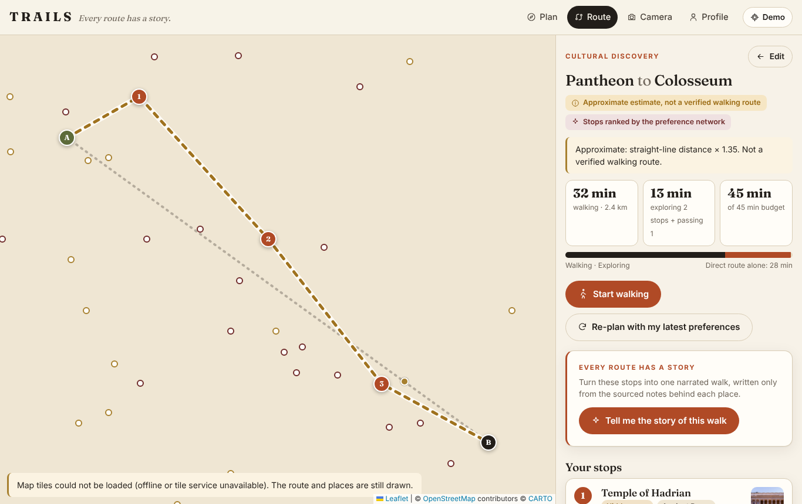

# TRAILS

**Every route has a story.** Navigation that learns what you love and reveals the history around you.

TRAILS is a mobile-first web app for walking through central Rome. You type any start and any
destination (an address, a hotel, a station, or a pin on the map) and the time you have. A small neural network scores 269 historical places for *you* (74 hand-curated, 195 imported from Wikidata and Wikipedia); a route
optimiser picks the stops worth the detour within your time budget; a pedestrian router walks you
there on OpenStreetMap data. Point your phone at one of 22 supported landmarks and TRAILS recognises it
from the image, pins a label on it and opens its history with sources.

Built for the AMD Developer Hackathon: ACT III (lablab.ai).



## What works (and how well)

| Feature | Status |
| --- | --- |
| Plan screen: any address or map pin as start/destination (OpenStreetMap search), time budget, 8 interests, 3 route modes, presets | Implemented, browser-tested with TRAILS places and map pins; live address search could not be reached from the build sandbox |
| Culture-rich path: stops to visit plus places the path is bent to walk past, and "also on your path" | Implemented, unit- and browser-tested |
| AI storyteller: one grounded, cited story for the walk, read aloud on request; model runs on an OpenAI-compatible endpoint (Gemma on AMD via vLLM/ROCm) | Implemented; tested with a stand-in model and the offline fallback; **not yet run with Gemma on AMD** ([docs/STORYTELLER.md](docs/STORYTELLER.md)) |
| Trade-off card: the TRAILS walk next to the fastest walk (extra minutes vs. places and strong matches on each), fastest walk drawn dotted on the map | Implemented, unit- and browser-tested |
| Walk mode audio guide: as you walk (GPS or simulated), each stop's part of the story, or its notes, and every place you pass is shown and read aloud as you get within 60 m | Implemented, unit- and browser-tested with the simulated walk; **not field-tested** with real GPS |
| Thumbs up / down ("More like this", "Not for me") on stops and in walk mode, with an immediate "your taste" readout and re-plan | Implemented, unit- and browser-tested |
| 195 more places imported automatically from Wikidata + the Wikipedia lead (`scripts/fetch_more_places.py`, `scripts/merge_more_places.py`), labelled in the app as not reviewed by hand | Implemented; dataset validator passes |
| Neural personalisation (PyTorch MLP → TS inference) that changes stops and routes | Implemented; tests show different interests give different stops |
| Preference learning from like / save / visited / read more / skip / not-for-me, editable and resettable | Implemented, unit-tested |
| Route optimiser (fastest / cultural discovery / maximum history) with hard time budget | Implemented, unit-tested (deterministic, budget respected) |
| Pedestrian routing: Valhalla → OSRM foot → labelled estimate, plus TRAILS' own A* router on a bundled OSM graph | Implemented. Valhalla parsing is tested against a **recorded real response**; live calls could not be made from the build sandbox. The Rome street graph (65,014 nodes from OpenStreetMap) is bundled, so routes follow real streets offline; browser-tested. |
| Map (Leaflet + OpenStreetMap/CARTO tiles), route line, stops, alternatives | Implemented; tiles could not load in the sandbox, so the offline fallback was exercised |
| Navigation: next instruction, next stop, remaining distance/time, GPS with consent or simulated walk | Implemented; simulated walk browser-tested; real GPS **not field-tested** |
| Camera recognition: live camera, held-out demo photos, photo upload, unknown state, 2D label overlay | Implemented; accuracy measured on held-out photos (below); live camera **not tested on a phone** |
| Place pages: image + licence, periods, themes, then & now, history, sources, related places | Implemented |
| AMD ROCm training path | Script supports ROCm; **only CPU has been run** (no AMD GPU available) |

Measured results (all reproducible, see "Tests"):

* **Preference MLP** (1,505 parameters, CPU, 11 s): held-out *synthetic* users AUC 0.740 vs 0.709 for a
  hand-written interest-overlap rule, 0.504 for popularity, 0.869 simulator ceiling. Synthetic data:
  this is not evidence of real-world recommendation quality.
* **Landmark recognition** (MobileNetV3-Small, 22 landmarks, 90 held-out photos, 30 photos of other
  landmarks): top-1 83.3 %; with the calibrated threshold 63.3 % recognised correctly, 0 % wrong,
  36.7 % "not sure"; 10 % of unrelated landmarks falsely accepted; ~76 ms per photo (6 crops) in
  headless Chromium on the build machine. MobileNetV3-Large measured 84.4 % / 72.2 % / 4.4 % wrong
  at 169 ms, see `docs/vision_eval_*.json`.

## Quick start

Requirements: Node 20+ (tested with Node 22), Python 3.10+ only for the ML and data scripts.

```bash
npm install          # also copies the MediaPipe wasm runtime into public/mediapipe
npm run dev          # http://localhost:5173  (use --host to open it on your phone)
npm run build        # production build into dist/
npm run preview      # serve the production build
npm test             # unit + integration tests (Vitest)
npm run story        # optional: serves dist/ + the AI storyteller API (see docs/STORYTELLER.md)
```

The camera needs HTTPS on phones. For a quick phone test, deploy (below) or use a tunnel such as
`npx localtunnel --port 5173`.

### Train the model

```bash
python -m venv .venv && . .venv/bin/activate      # Windows: .venv\Scripts\activate
pip install -r ml/requirements.txt
python ml/generate_data.py      # synthetic bootstrap data
python ml/train.py              # prints the device; writes ml/artifacts + public/models/preference_mlp.json
python ml/check_export.py       # PyTorch = ONNX Runtime = web weights
python ml/benchmark.py          # CPU (and AMD GPU if present) benchmark
```

AMD GPUs: see [docs/AMD_ROCM.md](docs/AMD_ROCM.md).

### Rebuild the recognition index

```bash
npm run dev &                     # the lab runs inside the real app
node scripts/vision_eval.mjs      # writes public/vision/reference_index.json + eval_report.json
```

Or open `#/lab` in a browser and press "Run evaluation".

### Refresh open data (needs internet)

```bash
python scripts/fetch_open_data.py --out data/open   # Wikipedia, Commons images, Overpass, Valhalla matrix
python scripts/apply_open_data.py --open data/open  # verified coordinates, QIDs, images, walking matrix
node scripts/build_walk_graph.mjs data/open/osm_walk.json   # bundled street graph for offline routing
python scripts/validate_dataset.py                  # schema, ids, duplicates, licences
```

## Environment variables (all optional, none secret)

| Variable | Default | Purpose |
| --- | --- | --- |
| `VITE_CARTO_KEY` | none | CARTO basemap key ([get one](https://carto.com/basemaps/apikey/)); without it CARTO shows "API key required" tiles. Put it in `.env.local` and restrict it to your domains |
| `VITE_TILE_URL`, `VITE_TILE_ATTRIBUTION` | CARTO Voyager | Map tiles (use your own provider for production traffic) |
| `VITE_VALHALLA_URL` | `https://valhalla1.openstreetmap.de` | Valhalla pedestrian routing |
| `VITE_OSRM_FOOT_URL` | `https://routing.openstreetmap.de/routed-foot` | OSRM foot routing |
| `VITE_EMBED_MODEL` | `mobilenet_v3_small` | Vision embedder (must match the reference index) |
| `VITE_PHOTON_URL`, `VITE_NOMINATIM_URL` | public OSM geocoders | Address search (type-ahead / explicit search) |
| `STORY_API_BASE`, `STORY_MODEL`, `STORY_API_KEY`, `STORY_PROVIDER_LABEL` | unset | Storyteller server only, never sent to the browser |

The app itself needs no API keys. The storyteller's key, if any, lives only in the server's environment.
Put local settings in `.env.local` (ignored by git).

## Running without external services

Everything except map tiles works offline: the dataset, model, photos, recognition model and wasm
runtime are bundled. Tick **Profile → Offline mode** to skip live routing. Stops are then chosen with
the bundled Valhalla walking matrix (if present) and the route is drawn from the bundled street graph
or, failing that, as a dashed estimate that the UI labels "not a verified walking route". If tiles
fail to load, the map shows a notice and still draws the route and places.

## Deployment

The app is a static site. `npm run build` and publish `dist/` to any HTTPS static host (Netlify,
Vercel, GitHub Pages, Cloudflare Pages). For a sub-path (GitHub Pages), build with
`npx vite build --base=/trails/`. HTTPS is required for the camera and geolocation.

## External services

| Service | Used for | When |
| --- | --- | --- |
| CARTO basemaps (OpenStreetMap data) | Map tiles | Always (not available offline) |
| FOSSGIS Valhalla / OSRM | Live pedestrian routes | Only if no bundled street graph, and not in offline mode |
| Photon (komoot) / Nominatim (OSMF) | Address search | When you type an address (TRAILS places work offline) |
| Your OpenAI-compatible model endpoint | Storyteller | Only via `npm run story` |
| Wikipedia, Wikimedia Commons, Overpass | Data refresh scripts | Build time only |

No Google Maps SDKs, APIs or data are used.

## Project layout

```
src/lib/model      preference MLP inference + feature schema (mirrors ml/features.py)
src/lib/routing    provider adapters, TRAILS A* walk-graph router, cache/timeout chain
src/lib/optimizer  cultural stop selection          src/lib/planner  end-to-end plan + budget check
src/lib/vision     embedder, recogniser, evaluation lab
src/screens        Home, Results, PlaceDetail, Navigate, Camera, Profile, About, Lab
ml/                data generation, training (ROCm/CPU), export, parity check, benchmark
data/rome          places.json, landmark_images.json, place_images.json; data/schema
scripts/           data fetch/apply/validate, image prep, walk graph, vision eval, smoke test
docs/              ARCHITECTURE, AMD_ROCM, DEMO, REPORT, DATA_SOURCES, screenshots
```

More: [Architecture](docs/ARCHITECTURE.md) · [Demo script](docs/DEMO.md) · [Final report](docs/REPORT.md) · [Data sources](docs/DATA_SOURCES.md)

## Licences

Code: MIT. Place texts: original short summaries by the TRAILS team, linking to Wikipedia. Photos keep
their Wikimedia Commons licences (CC BY / CC BY-SA, credited in-app and in `data/rome/*.json`). Map
data © OpenStreetMap contributors (ODbL). MobileNetV3 embedder model and MediaPipe: Apache 2.0.
